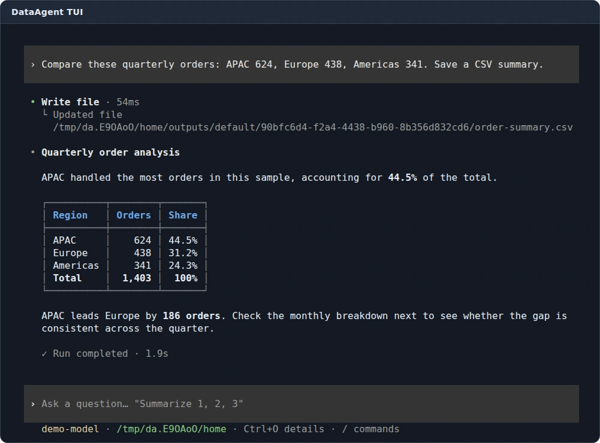

<h1 align="center">DataAgent</h1>

<p align="center">
  <strong>An enterprise-grade data agent</strong><br />
  Ask questions in natural language and keep results, generated files, and execution traces in the session.
</p>

<p align="center">
  <strong>English</strong> · <a href="README_zh.md">简体中文</a>
</p>

<p align="center">
  <a href="docs/en/quick-start.md"><strong>Quick start</strong></a> ·
  <a href="docs/en/index.md"><strong>Use and integration</strong></a> ·
  <a href="docs/development/index.md"><strong>Developer docs</strong></a> ·
  <a href="CONTRIBUTING.md"><strong>Contributing</strong></a> ·
  <a href="https://datagallery.cn/docs"><strong>Online docs</strong></a>
</p>

<p align="center">
  <a href="LICENSE"></a>
  <a href="docs/development/setup.md"></a>
  <a href="docs/en/guides/deploy-source.md"></a>
  <a href="CONTRIBUTING.md"></a>
  <br />
  <a href="docs/en/reference/rest-api.md"></a>
  <a href="docs/en/guides/tui.md"></a>
</p>

<p align="center">
  <a href="docs/assets/readme/gui-demo.gif"></a><br />
  <sub>Web workbench demo · <a href="docs/en/guides/web.md">Web workbench guide</a></sub>
</p>

## Core capabilities

- **Self-hosted deployment and multi-model support.** Run DataAgent on your own machine or server. Configure the default model and models for individual tools in [the server configuration](docs/en/guides/configuration.md).
- **Data and business context.** Give the agent [local input directories](docs/en/guides/inputs.md) for file analysis, enable [NL2SQL](examples/nl2sql-entry.yaml) for database questions, or connect an external [semantic service](docs/en/guides/integrate/extensions/semantic-service.md).
- **Reusable outputs and execution records.** Resume a [session](docs/en/guides/sessions-and-outputs.md) to follow up or retrieve its files. Use the [logs and traces](docs/development/architecture/observability.md) to inspect model and tool calls.

## Quick start

On Linux, install Git, Node.js 22.12+, and uv, then start from source:

```bash
git clone https://gitcode.com/datagallery/dataagent.git
cd dataagent
./deploy.sh
```

Set `LLM_MODEL`, `LLM_BASE_URL`, and `LLM_API_KEY` for your OpenAI-compatible model in the project's `.env`, then run `./deploy.sh restart`. Open the workbench URL printed by the script (defaults to `http://127.0.0.1:3000/data-tasks`), or run `./deploy.sh tui` to ask your first question from a terminal.

Use `./deploy.sh status` to check service health and `./deploy.sh logs` to follow the logs.

[Manual setup for Windows and macOS](docs/en/guides/deploy-source.md) · [Get the Server wheel and TUI package](docs/en/guides/deploy-packages.md#get-artifacts)

## How a data task runs

1. **Define the task.** Ask a question in natural language using the inputs and tools configured on the server.
2. **Run the analysis.** The agent uses the available tools to analyze inputs and saves generated files in the session's output directory.
3. **Review and follow up.** Open the same session to check the results, retrieve the files, or ask a follow-up question.

## Choose an interface

Use the Web workbench for day-to-day analysis and file previews, or the TUI when working from a terminal or over SSH. Both connect to the same server and can resume its sessions. To integrate the agent into your own application, use [REST and AG-UI](docs/en/reference/rest-api.md), [A2A](docs/en/reference/a2a.md), or the [Python SDK](docs/en/guides/integrate/sdk.md).

<p align="center">
  <a href="docs/assets/readme/readme-tui.webp"></a><br />
  <sub>Run the same analysis from a terminal · <a href="docs/en/guides/tui.md">TUI guide</a></sub>
</p>

## Documentation

| I want to | Start here |
| --- | --- |
| Analyze local files or query a database | [Local input directories](docs/en/guides/inputs.md) · [NL2SQL configuration example](examples/nl2sql-entry.yaml) |
| Resume a conversation or find a generated file | [Sessions and outputs](docs/en/guides/sessions-and-outputs.md) |
| Integrate an application or extend the tools | [REST and AG-UI](docs/en/reference/rest-api.md) · [A2A](docs/en/reference/a2a.md) · [Python SDK](docs/en/guides/integrate/sdk.md) · [Plugins and MCP](docs/en/guides/integrate/extensions/overview.md) |
| Configure a model or the server, or troubleshoot | [Configuration](docs/en/reference/configuration-api.md) · [Security](docs/en/concepts/security.md) · [Troubleshooting](docs/en/guides/troubleshooting.md) |
| Develop DataAgent or migrate from the legacy release | [Developer docs](docs/development/index.md) · [Legacy Python Runtime and CLI migration](docs/development/archive/main-legacy-migration.md) |

The server listens on `127.0.0.1` by default. See the [security guide](docs/en/concepts/security.md) when deploying it for access from other machines.

[Contributing](CONTRIBUTING.md) · [Community and examples](docs/en/community/index.md) · [Apache-2.0](LICENSE)
