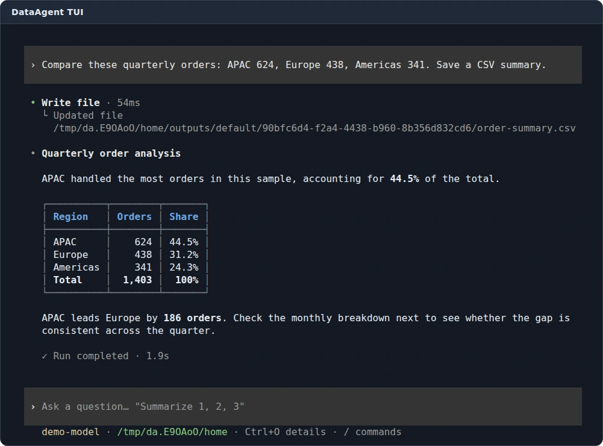

<h1 align="center">DataAgent</h1>

<p align="center">
  <strong>企业级 DataAgent</strong><br />
  用自然语言分析数据，在会话里查看结果、生成的文件和执行记录。
</p>

<p align="center">
  <a href="README.md">English</a> · <strong>简体中文</strong>
</p>

<p align="center">
  <a href="docs/zh/quick-start.md"><strong>快速开始</strong></a> ·
  <a href="docs/zh/index.md"><strong>使用与集成</strong></a> ·
  <a href="docs/development/index.md"><strong>开发者文档</strong></a> ·
  <a href="CONTRIBUTING.md"><strong>参与贡献</strong></a>
</p>

<p align="center">
  <a href="LICENSE"></a>
  <a href="docs/development/setup.md"></a>
  <a href="docs/zh/guides/deploy-source.md"></a>
  <a href="CONTRIBUTING.md"></a>
  <br />
  <a href="docs/zh/reference/rest-api.md"></a>
  <a href="docs/zh/guides/tui.md"></a>
</p>

<p align="center">
  <a href="docs/assets/readme/gui-demo.gif"></a><br />
  <sub>Web 工作台演示 · <a href="docs/zh/guides/web.md">Web 工作台指南</a></sub>
</p>

## 核心能力

- **私有化部署与多模型适配。** 在自己的电脑或服务器上运行 DataAgent，通过[服务端配置](docs/zh/guides/configuration.md)设置默认模型和各工具需要的模型。
- **接入数据与业务上下文。** 通过[本地输入目录](docs/zh/guides/inputs.md)分析文件，启用 [NL2SQL](examples/nl2sql-entry.yaml)查询数据库，或按需连接外部[语义服务](docs/zh/guides/integrate/extensions/semantic-service.md)。
- **复用产物与回查执行过程。** 恢复[会话](docs/zh/guides/sessions-and-outputs.md)继续追问或查找文件，通过[日志和 Trace](docs/development/architecture/observability.md)查看模型及工具调用。

## 快速开始

在 Linux 上准备 Git、Node.js 22.12+ 和 uv，再从源码启动：

```bash
git clone https://github.com/datagallery-lab/datafoundry.git
cd datafoundry
./deploy.sh
```

在项目的 `.env` 中填写 OpenAI 兼容模型的 `LLM_MODEL`、`LLM_BASE_URL` 和 `LLM_API_KEY`，再运行 `./deploy.sh restart`。打开脚本打印的工作台地址（默认 `http://127.0.0.1:3000/data-tasks`），或运行 `./deploy.sh tui` 在终端开始提问。

使用 `./deploy.sh status` 检查服务状态，使用 `./deploy.sh logs` 查看实时日志。

[Windows 与 macOS 手动部署](docs/zh/guides/deploy-source.md) · [Server wheel 和 TUI 安装包](docs/zh/guides/deploy-packages.md)

## 一条数据任务如何跑完

1. **定义任务。** 围绕服务端已配置的输入和工具，用自然语言描述想分析的问题。
2. **执行分析。** Agent 调用可用工具分析数据，并把生成的文件保存到会话产物目录。
3. **查看与追问。** 打开原会话查看结果、取回文件，或沿着已有对话继续提问。

## 选择使用入口

**Web 工作台**适合日常分析和文件预览，**TUI** 适合在终端或 SSH 环境下操作。两者连接同一个 Server，都可以恢复其中的会话。需要把 Agent 接入自己的应用时，可使用 [REST 与 AG-UI](docs/zh/reference/rest-api.md)、[A2A](docs/zh/reference/a2a.md) 或 [Python SDK](docs/zh/guides/integrate/sdk.md)。

<p align="center">
  <a href="docs/assets/readme/readme-tui.webp"></a><br />
  <sub>在终端运行同一份订单分析 · <a href="docs/zh/guides/tui.md">TUI 指南</a></sub>
</p>

## 文档

| 想做什么 | 从这里开始 |
| --- | --- |
| 分析本地文件或查询数据库 | [本地输入目录](docs/zh/guides/inputs.md) · [NL2SQL 配置示例](examples/nl2sql-entry.yaml) |
| 恢复对话或找回生成的文件 | [会话与产物](docs/zh/guides/sessions-and-outputs.md) |
| 接入应用或扩展工具 | [REST 与 AG-UI](docs/zh/reference/rest-api.md) · [A2A](docs/zh/reference/a2a.md) · [Python SDK](docs/zh/guides/integrate/sdk.md) · [插件与 MCP](docs/zh/guides/integrate/extensions/overview.md) |
| 配置模型、服务或排查问题 | [配置](docs/zh/reference/configuration-api.md) · [安全边界](docs/zh/concepts/security.md) · [故障排查](docs/zh/guides/troubleshooting.md) |
| 开发 DataAgent 或从旧版迁移 | [开发者文档](docs/development/index.md) · [旧版 Python Runtime 与 CLI 迁移](docs/development/archive/main-legacy-migration.md) |

Server 默认监听 `127.0.0.1`。需要从其他机器访问时，请参考[安全说明](docs/zh/concepts/security.md)。

[参与贡献](CONTRIBUTING.md) · [社区与案例](docs/zh/community/index.md) · [Apache-2.0](LICENSE)
