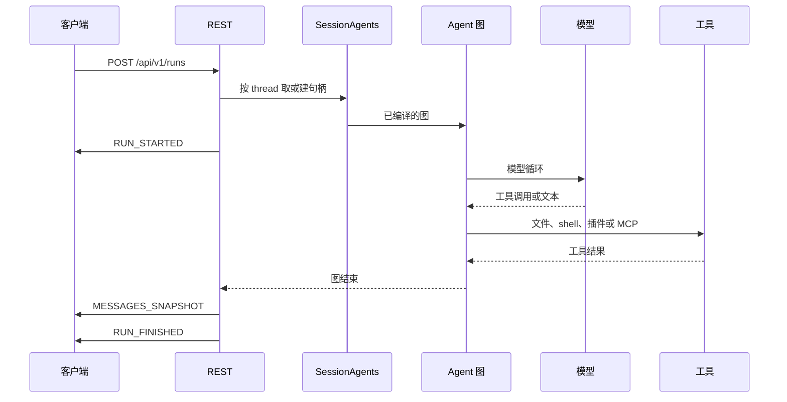

# 执行

一次 REST 查询从 HTTP 进入，到模型和工具调用结束。



## 会话句柄

`SessionAgents` 按 `(threadId, 输入绑定)` 缓存最多 32 个 Agent。同一时刻只有准备过程加锁。已经开始的流持有自己的图引用。

扩展变更在新一轮开始前检查。候选装配失败时，REST 返回 HTTP 500，旧缓存保留。刷新与发布步骤见[扩展生命周期](extension-lifecycle.md#refresh-and-cache)。

语义客户端在 REST 进程的 lifespan 里创建一次，传给所有句柄。进程退出时关闭。

Checkpoint 使用 `<stateDir>/checkpoints.sqlite` 的 `AsyncSqliteSaver`。同一 `stateDir` 的文件锁保证只有一个后端。

在嵌入式 SDK 中，一个 `Agent` 可以复用模型和语义服务客户端，同时按 `thread_id` 装配各自的会话图和文件 backend。首次调用确定该会话的产物目录，恢复时沿用同一绑定，让历史消息引用的文件仍可读取。示例见 [SDK 任务产物](../../zh/guides/integrate/sdk.md#task-outputs)。

## 图里有什么

未设置 `dataagent.entry` 时，`build_graph` 调用 `create_deep_agent`。产品放进去的中间件顺序是：

1. 根 Agent 的 `TodoListMiddleware`。子代理没有
2. 模型次数限制，超出则错误
3. 工具次数限制，超出则错误
4. 启用时的工具循环检测
5. 编译后的 Hook
6. `ToolErrorMiddleware`：只有 `ToolException` 变成可纠正文本
7. 有修订号时，再加会按修订刷新的 Skill 中间件

core 再装配文件系统、子代理、摘要和补丁工具调用，以及画像要求的其他层。产品配置、插件和子代理通过 Hook 扩展生命周期。

默认模型客户端是 `ChatOpenAI`，超时和重试分别来自 `timeout_seconds`、`max_retries`。标准子代理默认继承父 Agent 的模型，并支持模型别名和温度覆盖；编译型子代理通过工厂服务取得模型。声明见[子代理](../../zh/guides/integrate/extensions/subagents.md)。

会话文件系统使用真实路径，shell 超时采用 `timeout_seconds`。文件访问与进程权限见[安全边界](security-boundaries.md#files-and-processes)，长消息和工具结果的卸载策略见[上下文](context-management.md)。

## 入口图

`dataagent.entry` 有值时，图不是 Deep Agents 根。形状是一张 `MessagesState` 图：

```text
START → <entry> → END
```

唯一节点是该编译型子代理工厂交回的 Runnable。插件自己的 `StateGraph` 留在这个 Runnable 里面，宿主不调用插件的建图函数。`compile` 的名字和节点名都是入口名。`with_config` 写上与 core 相同的 `recursion_limit`（9999）和会话目录上的 `LocalLangChainTracer`。根 trace 的名字是入口名。

入口节点不设置 `emit-messages` 或 `emit-tool-calls`。工厂拿到的是 `AgentContext` 缓存里的原模型，不改 `disable_streaming`。正文 token、工具调用和推理按模型 chunk 进入前端。节点返回的回复仍在最终 `MESSAGES_SNAPSHOT`。`STEP_STARTED` 和 `STEP_FINISHED` 仍会发出。

会话 `outputs/` 仍传给工厂，结果文件落在这个会话目录。`dataagent.hooks`、调用上限和 `input_workspaces` 留在配置里，不装进这张图，也不因此报错。见 [入口模式](../../zh/guides/integrate/extensions/subagents.md#entry-mode)。错误入口不会让 `/healthz` 失败，响应里的 `entry` 仍是配置值。名字在插件工厂之前核对。`/api/v1/runs` 在第一次请求返回 HTTP 409。

## 一轮的边界

REST 用 `asyncio.timeout(timeout_seconds)` 包住整个上游迭代，包括重试等待和工具。入站 A2A 的时限只包住 Agent 的 `ainvoke`，不含排队、会话准备或 Checkpoint 保存，见 [A2A](../../zh/reference/a2a.md#request-diagnostics)。SDK 的 `ainvoke` 没有宿主总时限，由调用方自己限制。

AG-UI 默认的 `recursion_limit=25` 会被图自己的 limit 盖过，只转发图配置里的那一个值。

若图停在未完成的节点，服务返回 `RUN_ERROR`。失败或取消时，收尾会把本轮已经写入消息的 Checkpoint 记入会话索引；下一轮优先从索引指向的位置继续，没有该位置时读线程最新状态。恢复不等于重新执行或幂等重放。

<a name="hitl-recovery"></a>

## 人工反馈的执行与恢复

[人工反馈接入](../../zh/guides/integrate/extensions/hitl.md#answer-and-resume)描述阶段、回答和恢复动作。正常根图由[插件编译器](../../../dataagent/extensions/compiler.py)汇集已启用的策略，再由 [HITLMiddleware](../../../dataagent/extensions/hitl.py)完成暂停与恢复。

- 每个阶段的 durable prepare 任务按声明顺序准备命中的策略，将问题、参数、原工具调用和策略版本写入 Checkpoint。SQLite 恢复复用准备结果。相同阶段的策略依次处理，后面的恢复方法可看到前面的显式状态更新。待处理策略缺失、阶段或版本发生变化时，恢复失败。
- 工具通过 durable execute 任务缓存已完成的结果，从 `after_tool` 恢复时会复用结果。工具执行期间遇到进程退出仍可能重试，外部副作用需要幂等。中间件按照 before-tool、工具、after-tool 的顺序保留 reducer 增量，并在结果中提交一个对应原调用的工具消息。受 HITL 管理的工具支持普通工具结果和当前图的 `Command(update=dict)`。
- 私有 `hitl_history` 按交互 ID 合并，可在持有 Checkpoint 的宿主中通过 `graph.aget_state(config)` 查询。`source="external"` 表示回答通过恢复入口提交。

回归测试覆盖 [SQLite 重建和并行暂停](../../../tests/test_hitl.py)、[不同阶段的恢复动作](../../../tests/test_hitl_stages.py)、[reducer 更新顺序](../../../tests/test_hitl_reducers.py)以及 [HTTP](../../../tests/test_api_hitl.py) 和 [A2A](../../../tests/test_a2a_hitl.py) 的恢复流程。

<a name="loop-detection"></a>

## 复读与循环检测

检测只使用本地规则，不产生额外模型调用，不改变模型的流式设置。实现位于 `dataagent/extensions/loop_detection.py`，与 `extensions/tracing.py` 同层，只依赖 LangChain 公开接口。两类检测装在不同的位置：

- **工具循环**由 `LoopDetectionMiddleware` 检查。`assembly/graph.py` 的 `build_native_middleware()` 把它装进主代理和标准子代理，位置在调用次数上限之后、插件 Hook 之前。中间件钩子有准确的轮边界，命中时模型 span 已经结束，不会在追踪里留下未闭合的记录。
- **文本复读**由 `LoopDetectionCallback` 检查。装配图时通过 `with_config(callbacks=...)` 安装，LangChain 将其传递给内部模型和子代理调用。只有流式回调能在整段回复被消费完之前停下退化的解码，所以这部分留在回调上。

具体规则：

- **流式文本**：在最近 5,000 个字符中检查 50 字符片段。相同片段密集出现十次且间隔内容也重复时停止。文本和服务商公开的推理内容分开统计，工具参数 JSON 不作为文本检查。代码围栏内以及表格、列表、标题、引用、分隔线等本就会重复的 Markdown 结构行都跳过，避免正常输出触发。只有确认块级标记后才跳过结构行；粗体、斜体和行内代码前缀不豁免正文。围栏按 CommonMark 的行首、同字符和长度规则判断，反引号围栏的信息字符串不能含反引号，结束行在围栏后只能有空格或制表符。支持 LF、CRLF 和 CR 换行，包括跨流式分片的换行。非流式回复中同一通道的所有内容块都会检查；已在流式阶段检查过的通道不重复检查。非流式模型只能在回复完成后检查。
- **工具循环**：以"一次助手回复"为一步，检查本轮最近 25 步。长度为 1–5 的步骤序列连续重复五遍，且工具名、规范化参数、结果和状态都相同时停止。并行调用属于同一步，不会放大计数；结果按所属回复匹配，复用的 call ID 和并行结果不会串。结果有变化时继续，轮询工具可加入 `ignored_tools`。
- **工具循环重试**：本轮第一次命中时不终止。中间件追加一条 `name` 为 `loop_detection` 的用户消息，告诉模型同样的调用已重复五遍、结果相同，请换个方法或直接用已有信息回答，然后继续本轮。提示之前的步骤不再计数，提示之后再出现一次完整的循环才终止，所以每轮最多重试一次。提示消息保存在会话历史中。重试的模型调用计入 `model_calls_per_agent` 和 `limits.timeout_seconds`。

轮边界由 `before_agent` 在每次调用开始时记录，所以其他中间件在轮中插入的消息（摘要、评分复议、用于引用媒体的消息）不会重置计数，但一次新的用户请求会。复读命中或工具循环第二次命中后，SDK 抛出 `dataagent.LoopDetectedError`，REST 发出 `RUN_ERROR`，错误代码为 `LOOP_DETECTED`。不会自动重放任务或已完成的工具操作。可查看已完成步骤后发送新请求。异常中不包含原始文本或参数。修改检测配置需重启或重新创建 SDK 实例。

中间件自己发起的模型调用（上下文摘要、Rubric 评分）不是 Agent 的输出，不参与文本检测。

这些检查是启发式保护，有明确的覆盖边界：

- 设了 `dataagent.entry` 时，编译型入口自带图，不经过 `build_native_middleware`，因此**只有文本复读检测**，没有工具循环检测和工具循环重试。该入口的轮数约束仍由它自身的实现和 `limits.timeout_seconds` 承担。入口内部即使捕获异常并返回普通回复（如 NL2SQL），`build_entry_graph()` 也会在入口返回后重新抛出本次调用中记录的 `LoopDetectedError`。
- 通过 `task` 委派的编译型子代理也只有文本复读检测。它与编译型入口使用相同的异常传播保护：内部即使把循环异常转成普通回复，宿主仍会抛出 `LoopDetectedError` 并终止本轮，父代理不会继续调用模型。
- 没有插件声明 `general-purpose` 时，核心自动创建的通用子代理不继承自定义中间件，因此**没有工具循环检测**，只有文本复读检测。需要时由插件显式声明 `general-purpose` 子代理。
- 文本复读不重试。NL2SQL 节点和 UDN 场景包的 JSON 重试入口直接传播 `LoopDetectedError`，不会将其作为格式错误重试；validator 或 selector 命中后停止后续流程，不生成最终 CSV。HTTP 接口始终流式输出，重试时前端已经收到了复读文本，AG-UI 没有作废已发文本的事件。临时性模型错误（429、5xx、超时、断连）由模型 SDK 按 `models.<id>.max_retries` 重试，不另加中间件重试。
- Markdown 结构行豁免意味着整段由相同表格行或列表项组成的复读不会被文本检测拦住。这是为避免误伤正常的数据表输出而刻意保留的取舍，由工具循环检测和 `model_calls_per_agent`、`tool_calls_per_agent` 兜底。
- 上下文摘要重写历史后，记录的轮起点可能超出重写后的长度，此时检查范围偏短，只会漏报，不会把上一轮的调用算进本轮。
- 插件自行屏蔽回调的模型调用不在覆盖范围内；不公开的内部推理不可检查。客户端中止流不保证服务商立即停止计算，仍需保留 token、轮数和超时限制。

`enabled: false` 同时关闭两类检测，用于有意生成大量重复文本或有意重复调用工具的任务。

算法参考 [Gemini CLI LoopDetectionService](https://github.com/google-gemini/gemini-cli/blob/main/packages/core/src/services/loopDetectionService.ts)，按 dataagent 的原生中间件、回调和错误处理方式独立实现。

配置项和示例见[配置字段](../../zh/reference/configuration.md#dataagent)。
