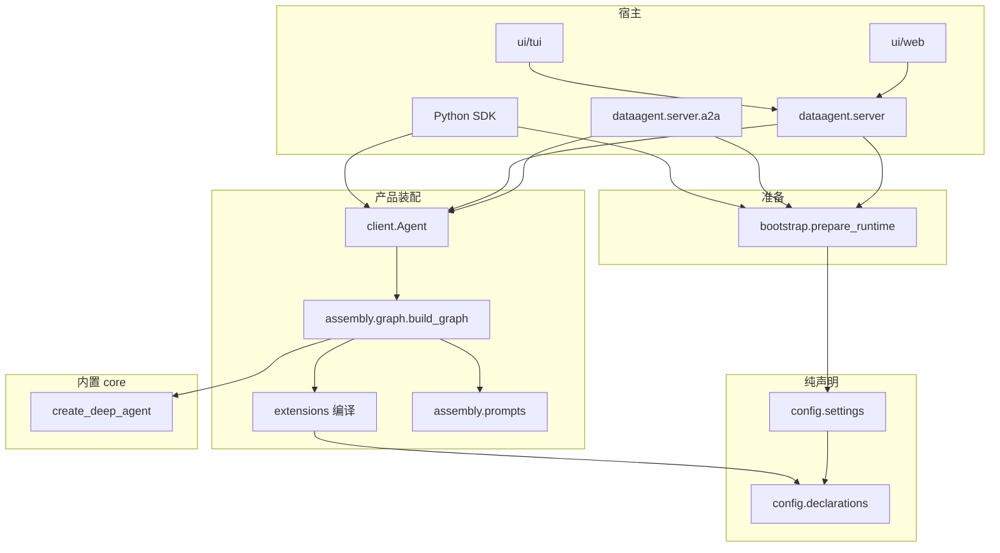

# 架构概览

DataAgent 把一次本地运行分成五层。上层可以调用下层。下层不反向导入宿主。

| 模块 | 职责 |
| --- | --- |
| `config/declarations.py` | 描述插件、Hook 和 MCP 的数据形状 |
| `config/settings.py` | 定义生效后的产品配置。配置读取器和插件清单解析也在 `config/` |
| `bootstrap/` | 解析路径、环境和配置，定位扩展，返回 PreparedRuntime |
| `extensions/` | 把选中的声明编译成 Deep Agents 参数 |
| `assembly/prompts/` | 把文件系统说明和扩展提示拼成文本 |
| `assembly/graph.py` | 加上限额、会话目录和 Trace，调用 `create_deep_agent` |
| `assembly/context.py` / `semantic_client/` | 提供模型客户端和语义 HTTP 客户端 |
| `model_stream.py` | 合并模型消息分片，插件可通过 SDK 调用 `collect_model_stream` |
| `client.py` | 实现 `Agent` 和 `create_agent`，按会话管理图并向 SDK 和 AG-UI 注入上下文 |
| `diagnostics/` | 定义结构化异常，渲染脱敏错误和日志事件，配置日志输出 |
| `dataagent/server/` | 提供健康检查、产品路由、会话索引和事件流 |
| `dataagent/server/a2a/` | 把同一张图暴露为 A2A 1.0 服务。`dataagent serve` 挂这组路由，`serve-a2a` 单独起进程 |
| `dataagent/core/` | 提供 Deep Agents 图、文件工具、摘要和子代理 |

宿主通过公开 SDK 和 `dataagent.host` 进入产品。首次为会话建图时，`client.py` 调用 `assembly.graph.build_graph`，后者把扩展和宿主配置装入引擎提供的图。后续调用由 `client.py` 取得并运行该会话的图。`bootstrap` 用 `config` 读取和校验配置，用 `diagnostics` 记录问题。`import dataagent` 保持轻量，LangChain 相关对象懒加载。

## 顺着运行过程读

- [启动](bootstrap.md)说明配置如何变成 PreparedRuntime。
- [执行](execution.md)说明宿主如何装配会话图，以及标准图与编译型入口的区别。
- [扩展生命周期](extension-lifecycle.md)记录插件编译、缓存和刷新如何协作。
- [Home 与工作区](home-layout.md)和[状态与存储](state-and-storage.md)说明目录、会话绑定和 Checkpoint。
- [上下文](context-management.md)、[可观测性](observability.md)和[安全边界](security-boundaries.md)说明运行时如何管理消息、诊断记录与访问。

客户端连接方式见[使用者架构概览](../../zh/concepts/architecture.md)，core 的维护约定见[内置 core](../core-maintenance.md)。
