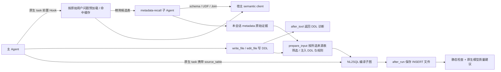

# de-agent：数据工程插件

将旧 `de_agent` Suite 的新建表和加列流程迁入 AgentKit。依赖内置 `nl2sql` 插件，通过原生 `task` 调用编译图，元数据召回使用标准子 Agent。

## 目录

```text
de-agent/
├── .plugin.json          # 工具、Hook、子 Agent 与依赖声明
├── tools/                # 元数据查询和交付检查的工具入口
├── utils/                # 共享证据、召回缓存、SQL 检查与语义调用辅助逻辑
├── hooks/                # 工具调用与 NL2SQL 运行 Hook
├── subagents/            # metadata-recall 声明
├── prompts/              # 主/子 Agent 提示词
└── skills/               # 新建表与加列工作流
```

入口使用插件内的相对文件路径；`tools/` 的位置不决定工具作用域，作用域仍由清单的 `scope` 和子 Agent 的工具列表控制。

## 启用

在完整 Agent 配置里加入：

```json
{
  "models": {
    "primary": {
      "name": "$env{LLM_MODEL}",
      "base_url": "$env{LLM_BASE_URL}",
      "api_key": "$env{LLM_API_KEY}"
    }
  },
  "semantic": {"base_url": "$env{SEMANTIC_BASE_URL}"},
  "plugins": {
    "enabled": ["de-agent"],
    "config": {
      "de-agent": {
        "allowed_databases": [],
        "quality_gate": true,
        "quality_gate_include_suggestions": false,
        "model": "primary"
      }
    }
  }
}
```

无需另外启用 `nl2sql`，无需 `setup()`。宿主管理 semantic client 和模型；插件通过 `runtime.context` 访问。切换模型别名时，同时覆盖 `plugins.config.nl2sql.model` 和 `plugins.config.de-agent.model`。

## 执行过程



默认节点：`perceptor → generator → validator → reflector`，不包含 executor 和 selector，因此不要求安装 Hive 执行驱动。SQL 安全检查默认关闭；旧 Suite 的 DDL/DML 方言规则作为交付检查保留。

语义粗召回不注册为模型工具。`prepare_recall` 在调用 `task(metadata-recall)` 前读取根 Agent 的原始用户消息，
按当前会话及 query 缓存成功结果，并把候选表名、描述、留存期注入委派内容；失败时返回工具错误，不启动无证据的召回子 Agent。
主 Agent 不持有 schema/UDF/Join 检索工具；召回子 Agent 使用四个元数据工具和原生 `ls/read_file`。
预加载放在 task 边界，是为了在默认隔离模式下仍使用原始用户问题，而不是把主 Agent 改写的委派当作粗召回 query。

`before_run` 从当前会话读取已有证据；必须先召回来源 schema、写入有效 `create_*.sql`。
主 Agent 调用原生 `task(subagent_type="nl2sql")` 时，`description` 使用以下 JSON 字符串：

```json
{"question": "完整生成需求，含唯一目标 temp.ads_example_ds", "source_table": ["warehouse.events", "warehouse.users"]}
```

这是 de-agent 的 `prepare_input` 输入约定；原生 task 工具和独立 NL2SQL 插件保持原接口。
`source_table` 必填，只含本次选定的来源表。Hook 按它筛选 Schema、候选表及两端均在列表内的 Join，
再将纯文本 `question` 交给 NL2SQL。缺少任何所选表 Schema 时，返回具体表名要求补查，不回退到全部证据。
有多份 DDL 时，`question` 必须包含唯一目标的完整 `db.table`。
`after_run` 校验返回的是一条 INSERT、目标与 DDL 一致，再保存文件。生成失败不会伪装成成功或空 CSV。`before_tool` 拒绝通过 write_file 首次创建 insert_*.sql，
以原生错误 ToolMessage 提示调用 NL2SQL；已有 INSERT 允许后续修订。

NL2SQL 上下文包含三个字段：`schema_str`（本次所选表的完整 schema，同表取最后一次）、
`evidence`（所选来源表列表、目标 DDL 路径与全文、筛选后的候选表、UDF、Join）和 `sql_rules`（完整 SQL_RULES 及仅生成限制）。
原始用户需求仍由工作流 `question` 承载。业务证据去除完全重复的记录，并递归去掉 diagnostic/diagnostics/toolTrace/reasoningTrace；
新证据按记录内的 `recorded_at_ns` 排序，避免文件修改时间相同时顺序不确定；去重保留最后一次出现。旧会话记录兼容使用文件修改时间。
粗召回只保留候选表信息，不把候选表的完整列副本、SQL 示例及后端轨迹整体塞入模型。交付检查复用同一证据投影。
保留所选表的全部字段及本会话已召回 UDF；不额外推断字段或 UDF 的取舍。原始会话证据不受本次筛选影响。

文件位置（相对于本会话 outputs）：

- `metadata/*.json`：工具调用的查询参数、类型和原始服务结果，保留完整数据库前缀。
- `.semantic/<query-hash>.json`：当前会话中原始问题的精简召回缓存，指向完整原始证据。
- `sql/create_<db.table>.sql`：主 Agent 创建的 DDL。
- `sql/insert_<db.table>.sql`：NL2SQL Hook 保存的生成结果。
- 加列流程按 skill 交付 `alter_*.sql` 和 `modified_insert_*.sql`。

## 本版边界

- 迁移元数据召回、表名/存在性检查、已有 INSERT 查询、DDL 反馈、SQL 生成与保存、交付检查、加列和特征工程 Skills。
- 未引入 DataTaskIR、任务信封或新任务工具；未迁入旧版禁用的 golden-schema 实验入口。
- 加列保留旧方式：读取已有 SQL 后由主 Agent 最小修改，不调用新建表 NL2SQL 流程。
- 静态检查继承原 Suite 的 Hive/平台规范；模型质量检查只报告有依据的问题和未验证项，不证明业务等价，也不执行仓库 SQL。
- 元数据错误返回可恢复的原生工具错误；不能将超时等同于“表不存在”。

## 验证

迁移快照的结果见 [迁移与验证说明](../../docs/de-agent-migration.md)：
2026-10-20 第 1–33 题评测全部完成，31 道 Agent 正常结束，32 道产出 DDL/INSERT；
语义 Judge 为 21 PASS、10 PARTIAL、1 FAIL、1 UNKNOWN。31 道最终产物通过静态检查。
第 2 题检索未收敛，第 13 题收尾达到步数上限，不能将其语义 PASS 计为完整成功。
上述成绩对应基线 `4b61bdd3` 的冻结快照，不代表后续同步到 `ec489ce` 的全量成绩。
同步后的检查另记于迁移说明；本轮没有执行 Hive SQL。

配置与 Hook 契约：`uv run pytest tests/test_plugin_configuration.py -q`。

真实 Agent 验收（真实 DeepSeek、真实语义后端，不使用 fake LLM）：

```sh
DATAAGENT_DE_AGENT_LIVE_ENV=/absolute/path/to/.env \
DATAAGENT_DE_AGENT_LIVE_URL=http://semantic-host:31333 \
uv run pytest tests/test_de_agent_live.py -q
```

该用例使用已存在的测试源表 `temp.tmp_dwd_adv_1688_intentions_crowd_ds`，只生成 SQL，不执行目标写入。

2026-10-20 首版验收（基线 `deepagents_refactor_new@4b61bdd3`）：

- 配置、编译、Hook、语义客户端配置相关检查：173 项通过；所有修改的 Python 文件通过 Ruff 格式与 lint 检查。
- 真实 DeepSeek + 已部署语义服务：2 项通过。覆盖主 Agent 原生 task 全链路、实际 DDL/INSERT 文件、交付检查完成状态、两个并发 NL2SQL 会话隔离、缺少证据时返回失败。
- 测试仅生成 SQL，没有执行 Hive 写入。加列与特征工程的完整业务案例尚未做端到端验收。
- 测试中 semantic/retrieve 曾超时，表字段接口正常。检索错误以原生工具错误返回；明确来源表直接查 schema，未知来源的语义召回可用性仍取决于后端。
