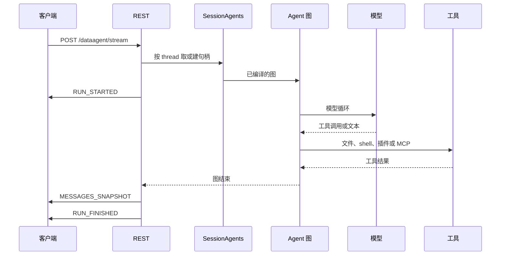

# 执行

一次 REST 查询从 HTTP 进入，到模型和工具调用结束。

## 会话句柄

`SessionAgents` 按 `(threadId, 输入绑定)` 缓存最多 32 个 Agent。同一时刻只有准备过程加锁。已经开始的流持有自己的图引用。

新查询开始前，若扩展指纹变了，先 `refresh_extensions`。MCP 连接变了就重新 `load_mcp_tools`。编译成功后清空缓存并换上新 Runtime。编译失败则这条查询返回 409，旧缓存保留。

语义客户端在 REST 进程的 lifespan 里创建一次，传给所有句柄。进程退出时关闭。

Checkpoint 使用 `<stateDir>/checkpoints.sqlite` 的 `AsyncSqliteSaver`。同一 `stateDir` 的文件锁保证只有一个后端。

## 图里有什么

`build_agent` 调用 `create_deep_agent`。产品放进去的中间件顺序是：

1. 根 Agent 的 `TodoListMiddleware`。子代理没有
2. 模型次数限制，超出则错误
3. 工具次数限制，超出则错误
4. 编译后的 Hook
5. `ToolErrorMiddleware`：只有 `ToolException` 变成可纠正文本
6. 有修订号时，再加会按修订刷新的 Skill 中间件

core 再装配文件系统、子代理、摘要和补丁工具调用，以及画像要求的其他层。产品配置、插件和子代理通过 Hook 扩展生命周期。

模型是 `ChatOpenAI`，超时等于 `timeout_seconds`，重试等于 `max_retries`。子代理使用同一默认模型。

文件系统后端是 `LocalShellBackend(virtual_mode=False)`。根目录为该会话 `outputs/`，shell 继承进程环境，超时使用同一个 `timeout_seconds`。`CompositeBackend` 把卸载文件放到 `outputs/artifacts/`。路径使用宿主上的真实路径。

## 一轮的边界

REST 用 `asyncio.timeout(timeout_seconds)` 包住整个上游迭代，包括重试等待和工具。SDK 的 `ainvoke` 没有这层总时限，由调用方自己限制。

AG-UI 默认的 `recursion_limit=25` 会被图自己的 limit 盖过，只转发图配置里的那一个值。

若图停在未完成的节点，服务返回 `RUN_ERROR`。恢复会话时使用上一份成功的 Checkpoint。
