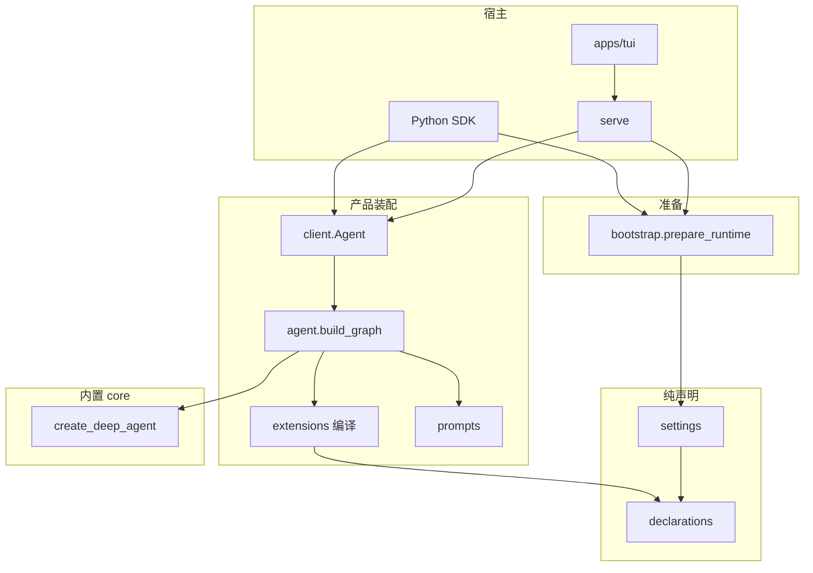

# 架构概览

AgentKit 把一次本地运行分成五层。上层可以调用下层。下层不反向导入宿主。



| 模块 | 职责 |
| --- | --- |
| `declarations.py` | 描述插件、Hook 和 MCP 的数据形状 |
| `settings.py` | 保存合并后的产品设置 |
| `bootstrap/` | 解析路径、环境和配置，定位扩展，返回 PreparedRuntime |
| `extensions/` | 把选中的声明编译成 Deep Agents 参数 |
| `prompts/` | 把文件系统说明和扩展提示拼成文本 |
| `agent.py` | 加上限额、会话目录和 Trace，调用 `create_deep_agent` |
| `models.py` / `semantic_client/` | 提供模型客户端和语义 HTTP 客户端 |
| `client.py` | 向 SDK 调用和 AG-UI 适配器注入运行上下文 |
| `serve/` | 提供健康检查、产品路由、会话索引和事件流 |
| `a2a_server/` | 把同一张图暴露为 A2A 1.0 服务。`dataagent serve` 挂这组路由，`serve-a2a` 单独起进程 |
| `dataagent/core/` | 提供 Deep Agents 图、文件工具、摘要和子代理 |

依赖方向：宿主 → `client`/`agent` → `extensions` 与 `core`。`bootstrap` 只依赖 `settings` 和 `declarations`。`import dataagent` 保持轻量，LangChain 相关对象懒加载。

## 一个服务，两种展示

Web 和 TUI 不是两套后端。它们都连接同一个 `dataagent serve` 进程。

```text
apps/web  --HTTP-->  dataagent serve  <--HTTP--  apps/tui
                         |
                    prepare_runtime
                         |
              ~/.dataagent 与 dataagent.workspaces
```

网页经 Next 同源转发。TUI 直接请求控制面。对话都走 `POST /api/v1/runs`。会话、Checkpoint 和产物在同一个 Home。Python SDK 可以跳过 HTTP，调用同一套 `prepare_runtime`。网页怎么部署、页面上能做什么，写在仓库 `docs/`，不在这篇架构说明里。

监听地址只有 `config.json` 的 `server.host` 和 `server.port`。目录布局见 [Home 与工作区](home-layout.md)。

一个状态目录同时只能有一个后端。锁文件是 `<home>/runtime/backend.lock` 上的操作系统锁，不是 PID 文件。
