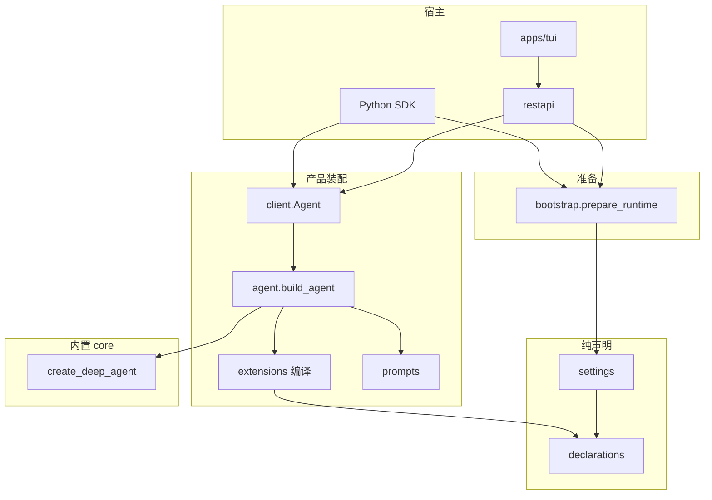

# 架构概览

AgentKit 把一次本地运行分成五层。上层可以调用下层。下层不反向导入宿主。

| 模块 | 职责 |
| --- | --- |
| `declarations.py` | 描述插件、Hook 和 MCP 的数据形状 |
| `settings.py` | 保存合并后的产品设置 |
| `bootstrap/` | 解析路径、环境和配置，定位扩展，返回 Runtime |
| `extensions/` | 把选中的声明编译成 Deep Agents 参数 |
| `prompts/` | 把文件系统说明和扩展提示拼成文本 |
| `agent.py` | 加上限额、会话目录和 Trace，调用 `create_deep_agent` |
| `models.py` / `semantic_client/` | 提供模型客户端和语义 HTTP 客户端 |
| `client.py` | 向 SDK 调用和 AG-UI 适配器注入运行上下文 |
| `restapi/` | 提供健康检查、会话索引和事件流 |
| `dataagent/core/` | 提供 Deep Agents 图、文件工具、摘要和子代理 |

依赖方向：宿主 → `client`/`agent` → `extensions` 与 `core`。`bootstrap` 只依赖 `settings` 和 `declarations`。`import dataagent` 保持轻量，LangChain 相关对象懒加载。

一个状态目录同时只能有一个后端。锁文件是 `<home>/runtime/backend.lock` 上的操作系统锁，不是 PID 文件。
