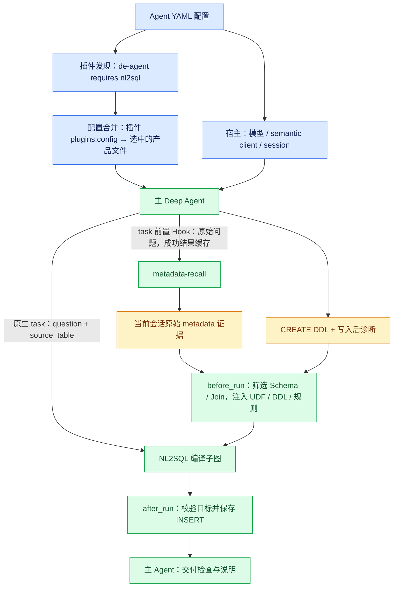

# de-agent 迁移与验证说明

## 目标与当前实现

在 AgentKit 中启用 `de-agent` 插件，完成元数据召回、目标 DDL、NL2SQL 生成与 SQL 文件交付。
主 Agent 和 metadata-recall 使用原生 Deep Agents；NL2SQL 是经原生 `task` 调用的编译子图。
宿主负责模型、语义客户端与会话目录，插件只组合业务工具、提示词、Skills 和 Hook。



### 插件配置与依赖

`.plugin.yaml` 新增 `requires`（本地插件 ID 列表）和 `config`（默认 JSON 片段路径）。
只启用 `de-agent` 就会加载它依赖的 `nl2sql`。依赖按拓扑顺序加载、共享依赖只加载一次；
缺失、循环或多个目录对应同一个 ID 都在启动时失败。它是运行时装配依赖，不是跨插件 Python import，
也不负责安装包、版本求解或调用插件 setup。

默认片段只允许贡献 `plugins.config`，不能覆盖宿主模型、连接或启用列表。
对象递归合并，普通数组后者覆盖前者；`hooks.before_run/after_run` 按来源追加，
空数组不删除先前 Hook。入口始终相对贡献配置的插件根或用户配置目录解析。

工具和 Hook 通过公开的 `runtime.context` 访问：

| 接口 | 用途 |
| --- | --- |
| `get_plugin_config("de-agent")` | 返回已启用插件的最终配置副本 |
| `session.outputs` | 当前 Agent 绑定会话的产物目录 |
| `get_model(alias)` | 复用宿主模型配置、创建和缓存 |
| `semantic_client` | 借用宿主管理生命周期的语义客户端 |

完整配置见 [示例](../examples/de-agent.yaml)。插件配置不能覆盖宿主默认模型选择；
业务组件改用另一个别名时，应显式配置 `plugins.config.nl2sql.model` 与 `plugins.config.de-agent.model`。

### Hook 与 metadata-recall

工具前置 Hook 可修改 `ToolCallRequest` 或直接返回可恢复的 `ToolMessage/Command`；
后置可替换结果，必须保持对应的 `tool_call_id`，并保留需要的 Command 状态更新。

编译工作流使用独立的 `services.run_hooks`。`before_run` 合并本次输入，
`after_run` 替换公开结果；前置正序、后置逆序，后置不能抹掉已有错误。
NL2SQL 工厂负责调用这些 Hook，宿主不会将它们自动套到所有标准子 Agent 上。

metadata-recall 使用四个语义工具：查 Schema、查 Join、按关键词查 UDF、按属性 DSL 查 UDF，
加原生 `ls/read_file`；主 Agent 没有这四个检索工具。粗召回由主 Agent 的 `task` 前置 Hook 完成，
使用原始用户问题，并按会话和问题缓存成功结果。反复委派补查会复用缓存。
失败不缓存，也不将超时解释成表不存在。

metadata-recall 返回证据摘要和文件位置。完整服务结果留在 `metadata/*.json`；
模型投影去除完全重复记录和 diagnostic/diagnostics/toolTrace/reasoningTrace。
粗召回仅保留候选表名、描述与留存期。

### NL2SQL 输入与交付

主 Agent 调用 `task(subagent_type="nl2sql")` 时，`description` 是 JSON 字符串：

```json
{"question":"完整需求，包含唯一目标 temp.ads_example_ds","source_table":["warehouse.events"]}
```

这是 de-agent 的 Hook 约定；没有新增 task 工具、DataTaskIR 或通用任务协议。
`source_table` 必须非空，使用小写完整 `db.table`。缺少任何所选表的 Schema 都要求补查。
输入包含所选表的完整 Schema、筛选后的候选表和两端均被选中的 Join、已检索 UDF、
目标 DDL、SQL_RULES 与仅生成限制。当前不进一步裁剪字段或筛选最终使用的 UDF。

默认流程为 `perceptor → generator → validator → reflector`，没有 executor/selector。
Perceptor 保留 Hook 显式注入的字段（包括空值），不再加载默认文件覆盖。
结果 Hook 接受一条与目标 DDL 一致的 INSERT，并保存至本会话 `sql/insert_<db.table>.sql`。
主 Agent 可以修订已有 INSERT。写入工具对首次创建 INSERT 的拦截是流程引导，
不是阻止 shell 写文件的权限隔离。

SQL 安全检查默认关闭。DDL/DML 静态规范检查和模型质量建议仍保留。
`validate_deliverables.valid` 表示静态检查结果；`quality_status=completed` 只表示模型检查已返回，
不意味着没有警告或业务等价。没有执行 Hive SQL。

### 代码位置

| 文件/目录（相对 runtime/agentkit） | 职责 |
| --- | --- |
| `dataagent/plugin_config.py`、`bootstrap/startup.py` | 依赖解析、默认片段装配、刷新 |
| `bootstrap/config_files.py`、`bootstrap/discovery.py` | 合并规则与 Hook 来源绑定 |
| `dataagent/models.py`、`agent.py`、`client.py` | 公开配置/会话访问、宿主服务注入 |
| `dataagent/declarations.py`、`extensions/` | 声明、工具可见性、原生 Hook 结果转换、编译子代理服务 |
| `builtin-plugins/nl2sql/subagents/nl2sql.py` | 工作流输入和结果 Hook |
| `builtin-plugins/nl2sql/nl2sql/` | 节点选择、输入覆盖状态与 Perceptor |
| `builtin-plugins/de-agent/tools/` | 元数据查询、交付检查的工具入口 |
| `builtin-plugins/de-agent/utils/` | 共享证据、召回缓存、SQL 检查与语义调用辅助逻辑 |
| `builtin-plugins/de-agent/hooks/` | 预召回、DDL 反馈、NL2SQL 输入筛选和产物保存 |
| `builtin-plugins/de-agent/prompts/`、`skills/` | 主/子 Agent 指令及加列、特征工程参考 |

## 全量验证：2026-10-20，第 1–33 题

批次：`agentkit_de_agent_pilot_20261020_173145_654353`。
基线：`deepagents_refactor_new@4b61bdd3f20efe43d43d12f4b6e6a1b0f1528dfd` 加本轮迁移修改。
运行前冻结源码和数据集，manifest 逐文件记录 SHA256。
Agent 为 `DeepSeek-V4.1-Flash`，Judge 为 `DeepSeek-V4-Flash-0731`，并发 3，
沿用 `sql_feature_default.yaml`；其 SHA256 为
`49dbc57f9a3e7925e45aa4936fb979e8a3a504f15a0e983644f7e0eecf117b80`。

### 结果分层

| 项目 | 结果 |
| --- | --- |
| 批次与评分 | exit code 0；33/33 存在 evaluation_result.json |
| Agent 正常结束 | 31/33；第 2、13 题失败 |
| DDL 与 INSERT 文件齐全 | 32/33；第 2 题两者均缺失 |
| 最终文件静态复查 | 31 题通过；第 13 题有 1 条 DML 告警；第 2 题无产物 |
| 实际调用交付检查 | 31 题、合计 56 次；这 31 题最终一次 valid=true 且 quality_status=completed |
| 过程评分 | 32 PASS、1 UNKNOWN；均分 0.9697 |
| SQL 语义 Judge | 21 PASS、10 PARTIAL、1 FAIL、1 UNKNOWN；均分 0.7879 |
| Agent 正常结束且语义 PASS | 20/33 |

第 13 题包含在语义 PASS 中，但不能计作完整成功。第 2 题因缺 SQL 无法提取评分主体，
SQL 维度没有 verdict；这里统一显示为 UNKNOWN，其零分已计入 33 题均值。
过程评分基于召回与工作区证据，不等同于运行收敛或 SQL 正确。

### 轨迹与成本

- 每题各保存 1 份粗召回响应，合计 33 份；metadata-recall 委派 41 次。
  这是已保存响应计数，不是 HTTP 传输重试计数。
- NL2SQL 委派 46 次，实际模型调用 116 次；逐次解析真实输入，116/116 的 Schema 表集合
  与该次 `source_table` 一致，未发现诊断字段进入 Schema/Evidence。
- UDF 关键词检索 285 次、DSL 18 次，每题合计中位数 7 次。
  第 2 题为 39 次、第 31 题为 32 次、第 21 题为 24 次，仍存在过度检索。
- 模型服务回传 token 合计 **56,401,259**：输入 53,777,832，输出 2,623,427；
  与逐模型 span 汇总一致。它不包含评测 Judge/归因消耗，也不是扣除缓存后的计费 token。
- 每题 Agent 用时中位数 **11.15 分钟**，合计 **523.49 分钟**。
  3 并发 Agent 阶段为 **177.20 分钟**；整个批次从 manifest 到 completion 约 **205.20 分钟**。
  工具耗时含父子调用重叠，不能相加当墙钟耗时。

### 失败与待修项

| 题号/问题 | 证据与处理范围 |
| --- | --- |
| 2：元数据补查不收敛 | 5 次 metadata-recall，某次子调用达到 130/128 工具上限；未进入 NL2SQL，耗时 46.63 分钟、11,020,623 token。后续需定位缺失证据与补查停止条件。 |
| 13：生成后收尾不收敛 | 已有 DDL/INSERT，但达到 300 步图限制，未调用交付检查；静态复查提示 `rn_dedup` 不在 CTE 来源中。语义 Judge PASS 不能消除运行失败与静态告警。 |
| 33：FAIL | Judge 指出 33 列宽表变为 10 列长表，同时行集、窗口百分位及精度发生变化。静态检查通过，业务输出仍不等价。 |
| 5、6、10、12、14、17、19、23、29、30：PARTIAL | Judge 指出的差异包括类型/精度、NULL 与 0、LEFT JOIN 后过滤、序列分隔符、写入分区、名称聚合和 SHA256 大小写处理。需结合题目、golden 与实际元数据逐题确认。 |
| UDF 与收尾开销 | 保留全部会话 UDF 证据；需后续缩小检索范围，并减少主 Agent 读插件源码、自写辅助检查等重复操作。 |
| Skills 边界 | 已迁入加列与特征工程参考；feature-engineering 仍有旧版执行 SQL/数据质量验收措辞，需后续与仅生成模式统一。未据本轮新建表评测宣称加列全流程已验收。 |

上述问题保留在当前基线中，没有通过提高上限或修改评分结果掩盖。
Judge 的业务差异属于待核对结论，没有数据库执行结果支撑；不能直接归因于重构引入回归。
没有迁入 business twin、traffic insight、DataTaskIR 或多策略选择实验。

### 与三题前测的关系

前测 `agentkit_de_agent_pilot_20261020_161656_257984`：第 1、3 题 PASS，第 2 题 PARTIAL，
三题 Agent 都正常结束，总 token 4,412,172。全量同三题分别 PASS、UNKNOWN、PASS，
说明第 2 题仍有运行不稳定性，不能从一次前测推断稳定完成。

更早的三题快照 `agentkit_de_agent_pilot_20261020_121043_544328` 到上述前测，
token 从 13,376,006 降至 4,412,172，且前测 NL2SQL 输入不再携带诊断轨迹。
这只是两次运行的观测对照；模型采样、服务响应和业务路径均可能变化，不作为受控性能提升证明。

### 评测快照与后续同步

上述 33 题结果对应基线 `4b61bdd3` 上的冻结快照。随后将迁移提交同步到
`deepagents_refactor_new@ec489ce`，保留上游新增的查询结果 CSV/元信息文件、
编译子 Agent 描述补充和会话 outputs 目录传递，并与本轮 run hooks、节点选择组合。
NL2SQL 描述按实际节点区分查询执行与仅生成模式，允许配置的输入 Hook 约定。
因此旧的 33 题成绩不是同步后代码的全量验证结果。

评测接入脚本、轨迹测试和逐题指标 JSON 只保留在本地，不纳入迁移提交。
同步后的 33 个变更 Python 文件通过 Ruff format、format --check、check；
配置、依赖、声明、Hook、来源表筛选和编译工厂契约检查 **205 passed**，
另有下述 2 项 TUI 用例未覆盖。`git diff --check` 无空白错误。

真实 `DeepSeek-V4.1-Flash` 回归通过两项检查：

- 使用先前保存的真实语义 Schema，两个独立会话并发调用编译 NL2SQL，生成各自 INSERT；
  缺失输入证据时返回错误，产物不串会话，不返回伪执行结果或 CSV。
- 主 Agent 经原生 task 调用独立 NL2SQL，执行本地 SQLite 部门计数查询；
  CSV、元信息文件、预览截断说明均存在，CSV 两行人数与本地数据一致。

在线 de-agent 全链路回归因 `semantic/retrieve`、表字段和 typedefs 接口连续返回 HTTP 502
而停止，未完成主 Agent → 在线语义召回 → 生成交付的再次验收。
已保存 Schema 的回归不证明当前语义服务可用；本次没有重跑 33 题。

当前检出没有构建 `apps/tui/dist/index.js`，两项 TUI 启动用例因 MODULE_NOT_FOUND 无法运行；
该限制单独记录，不包含在通过数内。

相关检查命令（在 `runtime/agentkit` 下）：

```sh
.venv/bin/pytest -q \
  tests/test_plugin_configuration.py tests/test_de_agent_contracts.py \
  tests/test_declarations.py tests/test_layering.py tests/test_config.py tests/test_home_startup.py \
  tests/test_json_config.py tests/test_semantic_configuration.py tests/test_launch.py \
  tests/test_nl2sql_plugin.py::test_legacy_yaml_sections_rejected_with_migration_hint \
  tests/test_nl2sql_plugin.py::test_node_sections_default_to_full_chain_and_require_prefix \
  tests/test_nl2sql_plugin.py::test_connection_config_strips_reserved_database_keys \
  tests/test_nl2sql_plugin.py::test_result_files_switch_must_be_boolean \
  tests/test_compiler_contract.py::test_compiled_factory_may_supplement_the_declared_description \
  tests/test_compiler_contract.py::test_compiled_factory_rejects_malformed_results \
  tests/test_compiler_contract.py::test_compiled_factory_receives_the_session_output_directory \
  -k 'not test_tui_starts_without_project_prompt_and_restores_terminal'
```

## 复现与证据

评测接入脚本与逐题精简指标 JSON 保留在本机，不随代码提交。
原始证据保留在本机评测根：

- `<eval-root>/.runtime/<batch>/manifest.json`、`completion.json`：源码/数据集哈希与批次退出信息。
- `<eval-root>/outputs/<batch>/summary.json`、`summary.csv`：评分汇总。
- `tasks/<id>/agent_result.json`、`evaluation_result.json`：运行与评分分别记录。
- `tasks/<id>/sql_files/`、`workspace/metadata/`、`workspace/.traces/`：SQL、原始服务响应、模型与工具轨迹。

本机 `<eval-root>` 为 `/Users/wistomize/ferry/sqlfeat-eval-20260924`。
不提交模型凭据、运行目录、缓存或大型轨迹。
